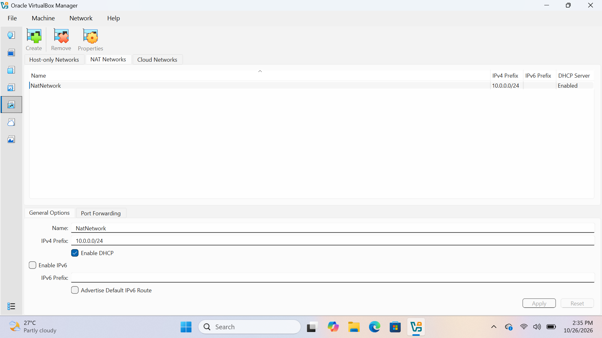
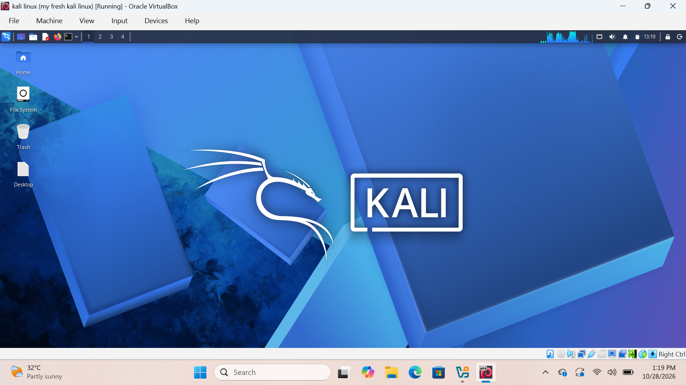
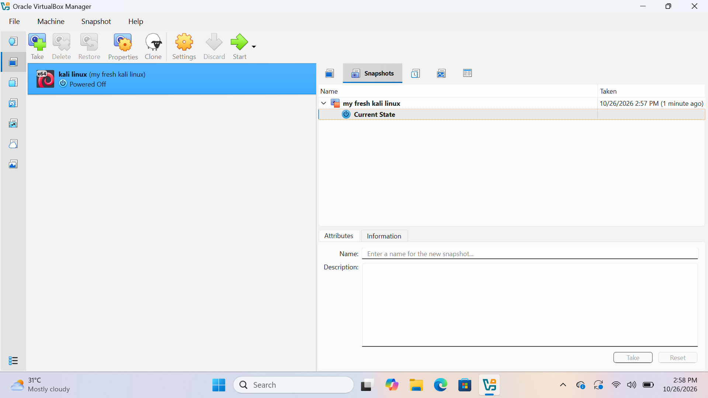

# Cybersecurity Lab Setup | Kali Linux & VirtualBox

Building a controlled virtual environment for cybersecurity learning, network analysis, and authorized security testing.


## 📌 Project Overview

This project documents the setup of a virtual cybersecurity lab using **Kali Linux and Oracle VirtualBox**.

The goal was to create a controlled environment where i work out cybersecurity tools that enables me to test software without changing my host operating system. A private virtual network was configured and the connectivity was tested.
This lab serves as the foundation for my hands on cybersecurity learning journey and future practical projects.

## 🎯 Project Objectives

- Install and configure VirtualBox.
- Set up Kali Linux as a virtual machine.
- Configure the virtual machine's NAT Network settings.
- Assign a consistent IP address to the kali VM.
- Check network connectivity and DNS resolution .
- Take a clean VM snapshot for recovery.
- Documentation.

## 🏗️ Lab Architecture

The lab consists of a host computer running VirtualBox, with Kali Linux operating inside a virtual machine.

```text
        HOST COMPUTER
        Windows 11 Pro
              |
         VirtualBox
              |
        Kali Linux VM
              |
     Virtual Network
              |
    Future Lab Machines
```


## ⚙️ Lab Configuration

| Component | Configuration |
|---|---|
| Host Operating System | Windows 11 Pro |
| Virtualization Software | Oracle VirtualBox |
| Guest Operating System | Kali Linux 2026.3 |
| Host RAM | 8 GB |
| Network address | 10.0.0.0/24|
| Virtual Network | NAT Network |
| DNS Server |8.8.8.8|


## 🛠️ Tools & Technologies

- **Kali Linux:** A Linux distribution designed for penetration testing and security auditing.
- **VirtualBox:** Virtualization software used to run Kali Linux separately from the host operating system.
- **Terminal:** Used to execute commands and inspect system and network information.
  

## 🚀 Implementation Process

### Step 1: Install VirtualBox

Installed Oracle VirtualBox on the host computer to create and manage virtual machines.

### Step 2: Set Up and configuration of  Kali Linux

kali linus was downloaded and configured  as a virtual machine(guest oprating system)  within VirtualBox.

### Step 3: Create the NAT Network
A NAT Network in virtualbox with the name: NATNetwork and IPV4 prefix: 10.0.0.0/24 was created

## step 4: create a clean VM snapshot
After completing the initial configuration, a virtualBox snapshot was created

### Step 4: Verify Network Connectivity

Tested connectivity using:

```bash
ping -c 4 8.8.8.8
ping -c 4 google.com
```

The first command checks connectivity to an IP address, while the second also depends on DNS resolution.

## 📸 Screenshots

### 1. Nat Network onfiguration



### 2. Kali Linux Desktop



### 3. virtualbox snapshot




## 💡 Key Learnings

Through this project, I gained practical experience with:

- Virtualization and virtual machine management.
- Setting up a Linux-based cybersecurity environment.
- Understanding virtual network adapters and connectivity.
- Inspecting IP addresses, routing, and DNS configuration.
- Using terminal commands to troubleshoot basic network issues.
- Documenting technical work using GitHub and Markdown.

The setup also helped me understand how a controlled lab environment supports safer, repeatable cybersecurity practice.

## 🔒 Security & Ethical Considerations

This lab is intended for educational purposes and authorized security testing only.

- Test only systems you own or have explicit permission to assess.
- Use isolated lab environments for practical security exercises.
- Avoid exposing vulnerable lab machines to untrusted networks.
- Keep the host operating system and virtual machine software updated.
- Create virtual machine snapshots before significant changes or experiments.

## 🔗 Resources

- [Kali Linux Official Website](https://www.kali.org/)
- [VirtualBox Official Website](https://www.virtualbox.org/)
- [Kali Linux Documentation](https://www.kali.org/docs/)
- [GitHub Markdown Guide](https://guides.github.com/features/mastering-markdown/)

## 👩‍💻 Author

**Favour**

Aspiring Cybersecurity Professional | Cybersecurity Learner

Currently building practical skills in cybersecurity, networking, Linux, and security analysis.

---

*This project is part of my ongoing cybersecurity learning journey. More hands-on labs and practical projects will be added as I continue to develop my skills.*


